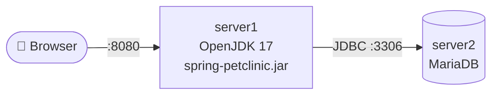

# Phase 1. 베어메탈 2-Tier

> 참고: 강의노트 「260608 실습 #1」 · VMware + Rocky Linux

## 환경

| 서버 | 역할 | OS | IP | vCPU / Memory |
| --- | --- | --- | --- | --- |
| server1 | WAS (PetClinic) | Rocky Linux | 192.168.100.10 | |
| server2 | DB (MariaDB) | Rocky Linux | 192.168.100.20 | |

- PetClinic 커밋: `          ` (`git rev-parse --short HEAD`)
- Java: OpenJDK 17 (`pom.xml`의 `java.version=17`)



---

## 진행 절차

> ⏱ 각 단계 시작 전에 `date`를 찍어 두고, 끝나면 다시 찍는다.

### 1. server2 — MariaDB

```bash
date                                              # ⏱ 시작
sudo dnf install mariadb mariadb-server -y
sudo systemctl enable --now mariadb.service

sudo mysql -u root
```

```sql
ALTER USER 'root'@'localhost' IDENTIFIED BY 'pass123!@#';
CREATE DATABASE petclinic;
CREATE USER 'petclinic'@'%' IDENTIFIED BY 'petclinic1234';
GRANT ALL PRIVILEGES ON petclinic.* TO 'petclinic'@'%';
FLUSH PRIVILEGES;
EXIT;
```

```bash
sudo firewall-cmd --permanent --add-port=3306/tcp
sudo firewall-cmd --reload
date                                              # ⏱ DB 준비 완료
```

### 2. server1 — JDK · 소스 · 빌드

```bash
date                                              # ⏱ 시작
sudo dnf install java-17-openjdk java-17-openjdk-devel git -y
java --version

git clone https://github.com/spring-projects/spring-petclinic.git
cd spring-petclinic
git rev-parse --short HEAD                        # 커밋 기록
```

DB 연결 정보 수정 — `src/main/resources/application-mysql.properties`

```properties
database=mysql
spring.datasource.url=jdbc:mysql://192.168.100.20:3306/petclinic
spring.datasource.username=petclinic
spring.datasource.password=petclinic1234   # ⚠️ 평문
spring.sql.init.mode=always
```

```bash
time ./mvnw package -DskipTests                   # ⏱ 빌드 시간
```

### 3. server1 — 실행

```bash
sudo firewall-cmd --permanent --add-port=8080/tcp
sudo firewall-cmd --reload

java -Dspring.profiles.active=mysql -jar target/spring-petclinic-*.jar
# 로그의 "Started PetClinicApplication in N seconds" 기록
```

### 4. 검증

1. 브라우저 `http://192.168.100.10:8080` 접속 → `date` ⏱ **완료**
2. Find Owners → Add Owner → Add New Pet 등록
3. server2에서 저장 확인

```sql
-- mysql -u petclinic -p
USE petclinic;
SELECT * FROM owners ORDER BY id DESC LIMIT 3;
```

---

## 📏 측정

| 항목 | 결과 |
| --- | --- |
| DB 준비 (설치 → 방화벽) | |
| WAS 준비 (설치 → 빌드 완료) | |
| `./mvnw package` 빌드 시간 | |
| 애플리케이션 기동 시간 (로그) | |
| **전체: 시작 → 브라우저 접속** | |

📸 캡처 → `docs/images/`
- `phase1-web.png` — 접속 화면
- `phase1-db-select.png` — owners 조회 결과
- `phase1-plaintext.png` — properties 파일의 평문 비밀번호

---

## ⚠️ 한계

- [ ] **수동 설치** — 서버가 늘면 같은 작업 반복, 순서·오타에 따라 결과가 달라짐
- [ ] **Java 버전 의존** — 서버 JDK 버전이 `pom.xml` 요구 버전과 다르면 빌드/실행 실패
- [ ] **비밀번호 평문 저장** — 소스 파일에 DB 비밀번호가 그대로 들어감
- [ ] **프로세스 관리 없음** — 터미널을 닫거나 프로세스가 죽으면 서비스 중단

➡️ 다음 단계: 실행 환경을 이미지로 고정 → [Phase 2](../02-docker/)
