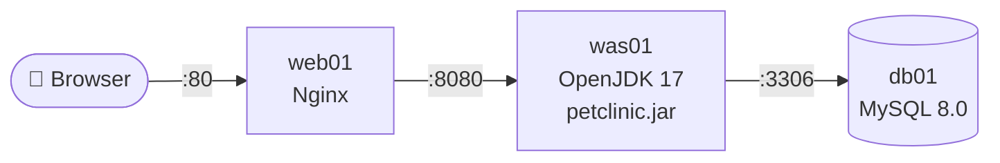

# Phase 1. VM 기반 전통적 3-Tier

> 참고: 강의노트 「260608 실습 #1」 · VMware + Rocky Linux
> VM 실습이므로 '베어메탈'이 아닌 **VM 기반 전통적 3-Tier**로 표기한다.

## 환경

| VM | 역할 | vCPU / Memory | IP | 열어 둘 포트 |
| --- | --- | --- | --- | --- |
| web01 | WEB — Nginx 리버스 프록시 | 1 / 1GB | | 80 (전체) |
| was01 | WAS — Spring PetClinic | 2 / 4GB | | 8080 (web01에서만) |
| db01 | DB — MySQL 8.0 | 1~2 / 2GB | | 3306 (was01에서만) |

- PetClinic 커밋: `          ` (`git rev-parse --short HEAD`)
- Java: OpenJDK 17 (`pom.xml`의 `java.version=17`)



> 아래 명령어의 `<WEB_IP>` `<WAS_IP>` `<DB_IP>`는 실제 IP로 바꿔서 실행한다.

---

## 0. 공통 확인 (3대 모두)

```bash
hostname; ip -4 addr | grep inet
sudo whoami                      # root
ping -c 2 8.8.8.8
```

VM 간 통신: web01 → was01, was01 → db01 `ping` 확인 → 📸 스냅샷 `00-base`

---

## 1. db01 — MySQL

```bash
date                                              # ⏱ 시작
sudo dnf install mysql-server -y
sudo systemctl enable --now mysqld
systemctl is-active mysqld
sudo mysql -u root
```

**최소 권한 계정** — was01 IP에서만 접속, `petclinic` DB에만 권한

```sql
ALTER USER 'root'@'localhost' IDENTIFIED BY 'Pass123!@#';
CREATE DATABASE petclinic;
CREATE USER 'petclinic'@'<WAS_IP>' IDENTIFIED BY 'petclinic1234';
GRANT SELECT, INSERT, UPDATE, DELETE, CREATE, INDEX, REFERENCES
  ON petclinic.* TO 'petclinic'@'<WAS_IP>';
FLUSH PRIVILEGES;
EXIT;
```

> `ALL PRIVILEGES` 대신 앱 동작에 필요한 권한만 부여 — 기동 시 `schema.sql`(CREATE TABLE·INDEX·FOREIGN KEY)과 `data.sql`(INSERT)을 실행하므로 위 권한이면 충분

**출발지 기반 방화벽** — was01에서만 3306 허용

```bash
sudo firewall-cmd --permanent --add-rich-rule='rule family="ipv4" source address="<WAS_IP>/32" port port="3306" protocol="tcp" accept'
sudo firewall-cmd --reload
sudo firewall-cmd --list-rich-rules
date                                              # ⏱ DB 완료
```

---

## 2. was01 — Spring PetClinic

```bash
date                                              # ⏱ 시작
sudo dnf install java-17-openjdk java-17-openjdk-devel git mysql -y
java --version

mysql -h <DB_IP> -u petclinic -p -e "SELECT 1;"   # DB 접속 사전 확인

git clone https://github.com/spring-projects/spring-petclinic.git
cd spring-petclinic
git rev-parse --short HEAD
```

`src/main/resources/application-mysql.properties`

```properties
database=mysql
spring.datasource.url=jdbc:mysql://<DB_IP>:3306/petclinic
spring.datasource.username=petclinic
spring.datasource.password=petclinic1234   # ⚠️ 평문
spring.sql.init.mode=always
```

```bash
time ./mvnw package -DskipTests                   # ⏱ 빌드 시간

sudo firewall-cmd --permanent --add-rich-rule='rule family="ipv4" source address="<WEB_IP>/32" port port="8080" protocol="tcp" accept'
sudo firewall-cmd --reload

java -Dspring.profiles.active=mysql -jar target/spring-petclinic-*.jar
# "Started PetClinicApplication in N seconds" 기록
```

---

## 3. web01 — Nginx 리버스 프록시

```bash
date                                              # ⏱ 시작
sudo dnf install nginx -y
```

`/etc/nginx/conf.d/petclinic.conf`

```nginx
server {
    listen 80;
    server_name _;

    location / {
        proxy_pass http://<WAS_IP>:8080;
        proxy_set_header Host              $host;
        proxy_set_header X-Real-IP         $remote_addr;
        proxy_set_header X-Forwarded-For   $proxy_add_x_forwarded_for;
        proxy_set_header X-Forwarded-Proto $scheme;
    }
}
```

```bash
sudo nginx -t
sudo setsebool -P httpd_can_network_connect 1     # SELinux: Nginx의 외부 연결 허용
sudo systemctl enable --now nginx
sudo firewall-cmd --permanent --add-service=http
sudo firewall-cmd --reload
```

---

## 4. 검증

1. 브라우저 `http://<WEB_IP>` 접속 → `date` ⏱ **완료**
2. Find Owners → Add Owner → Add New Pet
3. db01에서 저장 확인

```sql
-- sudo mysql -u root -p
USE petclinic;
SELECT * FROM owners ORDER BY id DESC LIMIT 3;
```

4. **경로 차단 확인** — 우회 접근이 막히는지

```bash
curl -m 3 http://<WAS_IP>:8080        # 내 PC/db01에서 → 실패해야 정상
nc -zv -w 3 <DB_IP> 3306              # web01에서 → 실패해야 정상
```

---

## 📏 측정

| 항목 | 결과 |
| --- | --- |
| db01 준비 (설치 → 방화벽) | |
| was01 준비 (설치 → 빌드 완료) | |
| `./mvnw package` 빌드 시간 | |
| 애플리케이션 기동 시간 (로그) | |
| web01 준비 (설치 → 프록시 동작) | |
| **전체: 시작 → 브라우저 접속·DB 저장 확인** | |

📸 캡처 → `docs/images/`
- `phase1-web.png` — Nginx 경유 접속 화면
- `phase1-db-select.png` — owners 조회 결과
- `phase1-plaintext.png` — properties 파일의 평문 비밀번호
- `phase1-firewall.png` — 우회 접근 차단 결과

---

## ⚠️ 한계

- [ ] **수동 설치** — 서버 3대에 같은 작업 반복, 순서·오타에 따라 결과가 달라짐
- [ ] **Java 버전 의존** — was01의 JDK가 `pom.xml` 요구 버전과 다르면 빌드/실행 실패
- [ ] **설정 파일의 DB 비밀번호** — 소스 내 properties 파일에 평문으로 저장
- [ ] **서버별 장애 대응** — 프로세스가 죽거나 VM이 멈추면 사람이 직접 확인·재시작

➡️ 다음 단계: 실행 환경을 이미지로 고정 → [Phase 2](../02-docker/)
