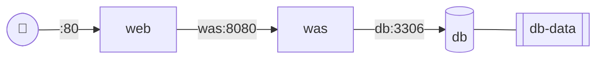

# Phase 3. Docker Compose

## 파일

| 파일 | 설명 |
| --- | --- |
| `docker-compose.yml` | web(Nginx) + was(PetClinic) + db(MySQL 8.0), 네트워크, DB 볼륨 |
| `nginx/default.conf` | `proxy_pass http://was:8080` |
| `.env.example` | DB 접속 정보 예시 (실제 `.env`는 커밋하지 않음) |



## 배포

```bash
cp .env.example .env   # 값 수정
time docker compose up -d
docker compose ps
```

## 📏 측정

| 항목 | 결과 |
| --- | --- |
| `docker compose up -d` → 접속 확인 | |
| 웹 등록 → `db` 컨테이너 저장 확인 | |

## 🧪 복구 비교 — 재시작 정책

```bash
docker compose ps                  # 종료 전 상태
docker kill <was 컨테이너>         # 강제 종료
docker compose ps                  # 복구 여부
```

| `restart:` 설정 | 강제 종료 후 동작 | 복구 시간 | 캡처 |
| --- | --- | --- | --- |
| 없음 | | | |
| `always` | | | |

## ⚠️ 한계 — Compose vs Kubernetes

| 구분 | Compose 재시작 정책 | Kubernetes |
| --- | --- | --- |
| 복구 기준 | 컨테이너 프로세스 종료 | 원하는 상태(replicas) 유지 + liveness/readiness |
| 실행 위치 | 단일 호스트 | 노드 장애 시 다른 노드로 스케줄링 |
| 복제본 | 수동 관리 | Deployment가 개수 유지 |
| 배포 | 재생성 (중단 발생) | 롤링 업데이트 · 롤백 |
| 스케일링 | 수동 | HPA |

➡️ 다음 단계: 오케스트레이션 → [Phase 4](../04-k8s/)
