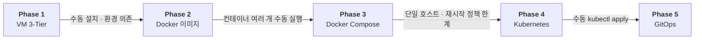
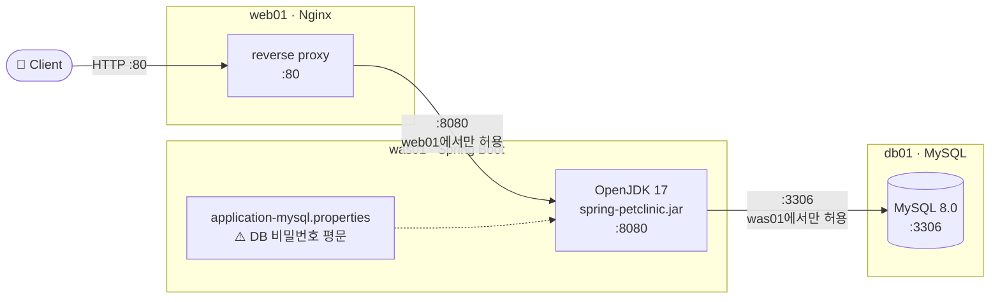
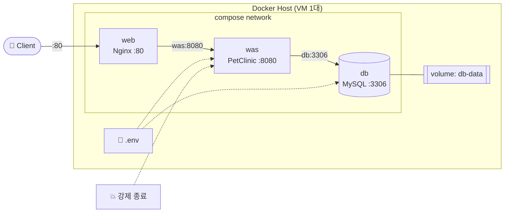
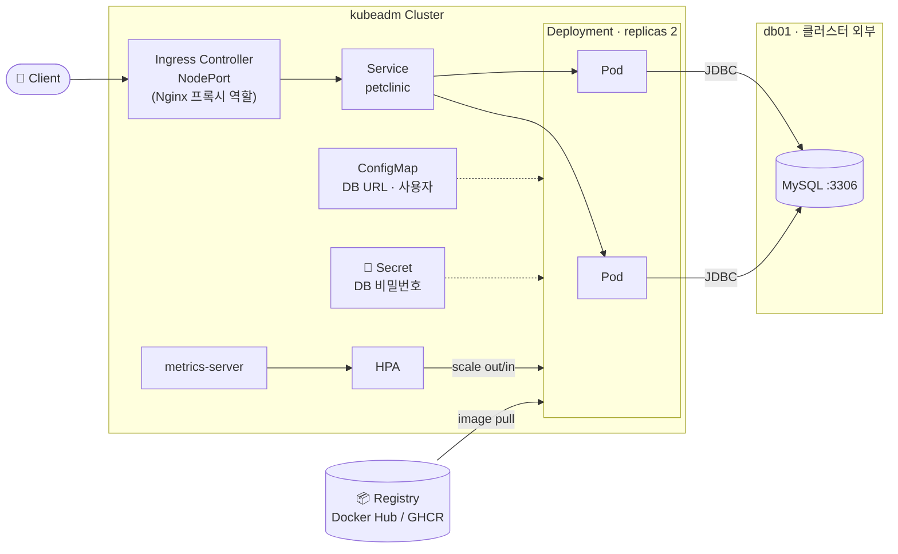

# 🐳 Spring PetClinic 배포 아키텍처 단계적 전환

> VM 기반 3-Tier → Docker → Docker Compose → Kubernetes(kubeadm) → GitOps
> WEB(Nginx) · WAS(Spring Boot) · DB(MySQL) 3-Tier 앱 하나로 배포 방식을 단계적으로 바꾸며, **각 단계의 한계를 다음 단계로 해결**한 과정과 수치를 기록합니다.


---

## 📌 목차

- [전체 흐름](#-전체-흐름)
- [Phase 1. VM 기반 전통적 3-Tier](#phase-1-vm-기반-전통적-3-tier)
- [Phase 2. Docker 이미지화](#phase-2-docker-이미지화)
- [Phase 3. Docker Compose](#phase-3-docker-compose)
- [Phase 4. Kubernetes (kubeadm)](#phase-4-kubernetes-kubeadm)
- [Phase 5. GitOps](#phase-5-gitops)
- [측정 결과 요약](#-측정-결과-요약)
- [트러블슈팅](#-트러블슈팅)
- [디렉토리 구조](#-디렉토리-구조)

---

## 🗺 전체 흐름



| Phase | WEB | WAS | DB | 해결한 문제 | 남은 한계 |
| --- | --- | --- | --- | --- | --- |
| 1 | Nginx (VM) | Java 프로세스 (VM) | MySQL (VM) | – | 수동 설치, Java 버전 의존, 설정 파일 비밀번호, 서버별 장애 대응 |
| 2 | Nginx 컨테이너 | PetClinic 이미지 | MySQL (VM) | 실행 환경을 이미지로 고정 | 컨테이너·네트워크를 매번 수동 실행 |
| 3 | Compose 서비스 | Compose 서비스 | Compose 서비스 + 볼륨 | 3-Tier를 한 줄로 배포 | 단일 호스트, 재시작 정책만으로는 복제본 유지·재배치 불가 |
| 4 | Ingress Controller | Deployment ×2 + HPA | MySQL (외부 VM) | 자가 복구, 롤링 업데이트·롤백, 오토스케일링, Secret | 배포가 수동 `kubectl apply` |
| 5 | ← | GitHub Actions + ArgoCD | ← | Git push → 자동 빌드·배포 | – |

---

## Phase 1. VM 기반 전통적 3-Tier

**목표:** 컨테이너 없이 VM 3대에 직접 설치해 기준점(baseline)을 만든다.



- [ ] Rocky Linux VM 3대: `web01`(Nginx) · `was01`(PetClinic) · `db01`(MySQL)
- [ ] 출발지 기반 방화벽: 80(전체) · 8080(web01 → was01) · 3306(was01 → db01)
- [ ] MySQL에 PetClinic DB + 최소 권한 계정
- [ ] WEB → WAS → DB 기능 검증
- [ ] **측정:** 설치 시작 → 브라우저 접속·DB 저장 확인까지 시간
- [ ] **한계 기록:** 수동 설치 / Java 버전 의존 / 설정 파일 비밀번호 / 서버별 장애 대응

➡️ 상세: [`01-vm-3tier/`](01-vm-3tier/)

---

## Phase 2. Docker 이미지화

**목표:** WAS 실행 환경을 이미지로 고정하고, 멀티스테이지 빌드로 이미지 크기를 줄인다.

```mermaid
flowchart TB
    SRC["📦 PetClinic 소스"]

    subgraph A["A. 단일 스테이지"]
        A1["JDK 베이스<br/>빌드 + 실행"] --> AIMG["petclinic:single<br/>📏 ○○○ MB"]
    end

    subgraph B["B. 멀티스테이지"]
        B1["Stage 1: build<br/>JDK + Maven → .jar"] -- "jar만 복사" --> B2["Stage 2: runtime<br/>JRE 베이스"]
        B2 --> BIMG["petclinic:multi<br/>📏 ○○○ MB"]
    end

    SRC --> A1
    SRC --> B1
    AIMG & BIMG --> CMP{{"docker images<br/>크기 비교"}}

    subgraph RUN["실행 확인"]
        N["nginx 컨테이너<br/>:80"] --> W["petclinic 컨테이너<br/>:8080"] --> D[("db01 MySQL")]
    end
    BIMG -.-> W
```



- [ ] WAS 단일 스테이지(JDK) / 멀티스테이지(JDK 빌드 + JRE 실행) 이미지 빌드
- [ ] Nginx 설정을 컨테이너용으로 준비, WEB → WAS 프록시 확인
- [ ] **측정:** `docker images`로 두 WAS 이미지 크기 비교

➡️ 상세: [`02-docker/`](02-docker/)

---

## Phase 3. Docker Compose

**목표:** 3-Tier 전체를 한 줄로 배포하고, 재시작 정책의 복구 범위를 확인한다.



- [ ] WEB + WAS + DB 3개 서비스, 네트워크·DB 볼륨 구성
- [ ] `docker compose up -d` 배포 시간 측정
- [ ] **복구 비교:** 재시작 정책 없음 vs `restart: always`에서 컨테이너 강제 종료 후 동작
- [ ] **한계 기록:** 재시작 정책 vs Kubernetes 복제본 유지·스케줄링·상태 기반 복구

➡️ 상세: [`03-compose/`](03-compose/)

---

## Phase 4. Kubernetes (kubeadm)

**목표:** kubeadm 클러스터를 직접 구축하고, Nginx 프록시를 Ingress로 전환하며 자가 복구·롤백·오토스케일링을 수치로 확인한다.



> **DB 설계:** MySQL은 클러스터 밖 `db01` VM에 두고 K8s 앱이 외부 DB에 접속 — DB의 지속성·운영 책임을 앱과 분리. 실무에서는 관리형 DB나 StatefulSet도 사용한다.
> **WEB 설계:** Phase 1·3의 Nginx 리버스 프록시 → Ingress Controller + Ingress로 전환하고 트래픽 흐름을 비교한다.

| 항목 | 할 일 | 남길 증거 | 완료 |
| --- | --- | --- | --- |
| 배포 | WAS Deployment(replicas 2) + Service + Ingress | `kubectl get deploy,pod,svc,ingress -A` | ☐ |
| 설정 분리 | DB 접속 정보 ConfigMap, 비밀번호 Secret | 전후 비교 · RBAC/etcd 암호화 확인 | ☐ |
| 자가 복구 | Pod 강제 삭제 | 재생성 시간 (Phase 3과 대비) | ☐ |
| 롤링 업데이트 | v1 → v2, 잘못된 이미지로 실패 → `rollout undo` | 복구 시간 | ☐ |
| HPA | 부하 테스트로 스케일아웃 | Pod 수 변화 캡처 | ☐ |
| 장애 재현 | 메모리 limit 초과 → OOMKilled | `kubectl describe` | ☐ |

➡️ 상세: [`04-k8s/`](04-k8s/)

---

## Phase 5. GitOps

**목표:** Git push만으로 빌드부터 클러스터 배포까지 자동화한다. *(수업에서 ArgoCD 학습 후 진행)*


- [ ] GitHub Actions로 이미지 빌드·푸시
- [ ] ArgoCD로 kubeadm 클러스터 자동 배포
- [ ] (선택) EKS 확장

➡️ 상세: [`05-gitops/`](05-gitops/)

---

## 📊 측정 결과 요약

> 실습하면서 채워 나갑니다. 측정 방법은 각 Phase 폴더의 README에 기록합니다.

| 지표 | Phase 1 | Phase 2 | Phase 3 | Phase 4 |
| --- | --- | --- | --- | --- |
| 배포 소요 시간 | – | – | – | – |
| WAS 이미지 크기 (단일 → 멀티스테이지) | | – → – | | |
| WAS 장애 후 복구 | 수동 재시작 | | 정책 없음: – / always: – | – |
| 롤백 소요 시간 | | | | – |
| HPA Pod 수 변화 | | | | – → – |
| DB 비밀번호 저장 방식 | properties 평문 | | `.env` | Secret |

---

## 🧯 트러블슈팅

막힌 부분은 바로 [`docs/troubleshooting.md`](docs/troubleshooting.md)에 기록합니다.

**미리 알고 가는 함정**

| 증상 | 원인 | 대응 |
| --- | --- | --- |
| `ImagePullBackOff` | 로컬 빌드 이미지는 워커 노드에 없음 | Docker Hub / GHCR에 push 후 사용 |
| HPA `TARGETS <unknown>` | metrics-server가 kubelet 인증서 검증 실패 | `--kubelet-insecure-tls` (실습 환경 한정) |
| Pod Pending / OOMKilled | Java 앱 메모리 사용량 큼 | 노드 가용 메모리 확인 후 실제 사용량 기준으로 requests/limits 지정 |
| Secret이 안전하다는 착각 | 기본은 Base64 인코딩일 뿐 암호화 아님 | RBAC 범위, etcd 저장 시 암호화 여부 확인 |

---

## 📁 디렉토리 구조

```
petclinic-migration/
├── 01-vm-3tier/    # Phase 1: VM 3대 설치 절차, 측정 기록
├── 02-docker/      # Phase 2: Dockerfile (single / multi-stage), nginx 설정
├── 03-compose/     # Phase 3: docker-compose.yml, .env.example
├── 04-k8s/         # Phase 4: Deployment, Service, Ingress, ConfigMap, Secret, HPA
├── 05-gitops/      # Phase 5: GitHub Actions, ArgoCD Application
└── docs/
    ├── images/            # 캡처 이미지
    └── troubleshooting.md # 문제 → 원인 → 해결 기록
```

## 🔗 참고

- 애플리케이션: [spring-projects/spring-petclinic](https://github.com/spring-projects/spring-petclinic)
- 실습 환경: 한국폴리텍대학 서울정수캠퍼스 클라우드컴퓨팅 과정 (Docker · Terraform · K8s 수업 연계) · VMware + Rocky Linux
