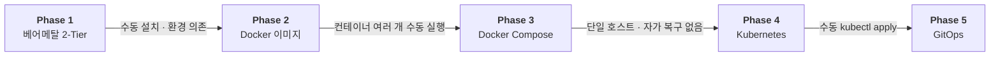
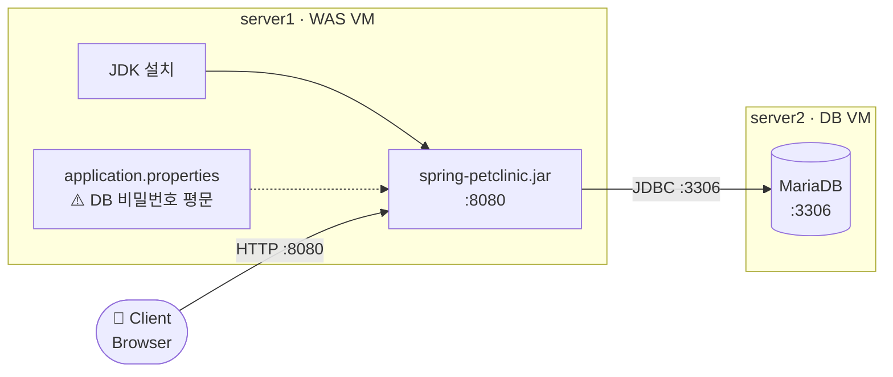
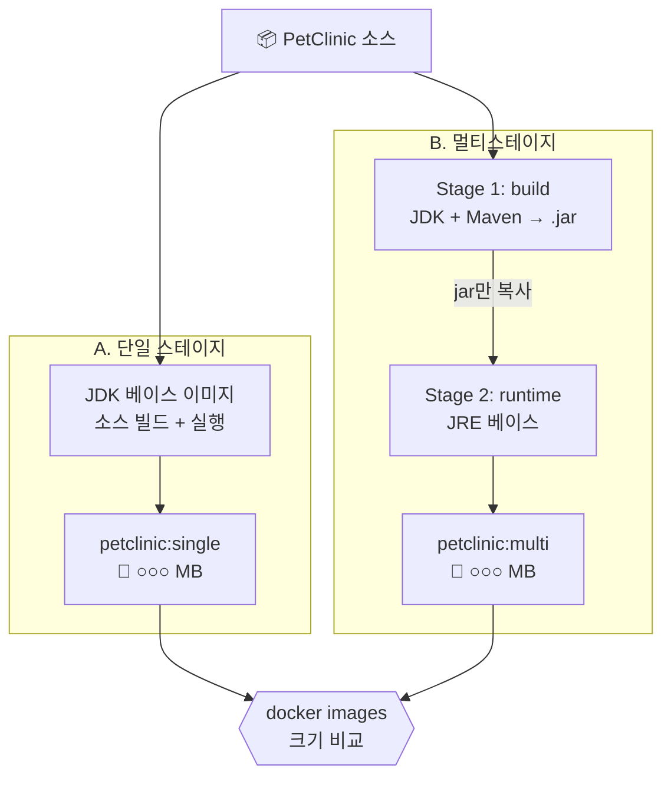
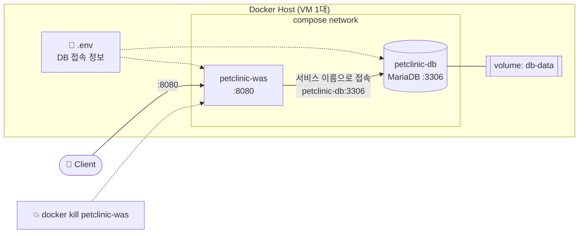
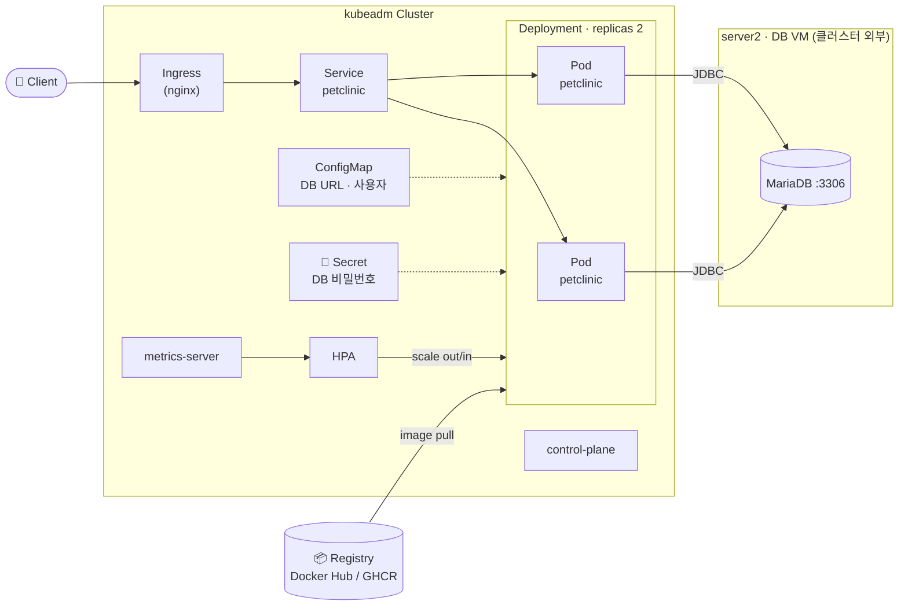
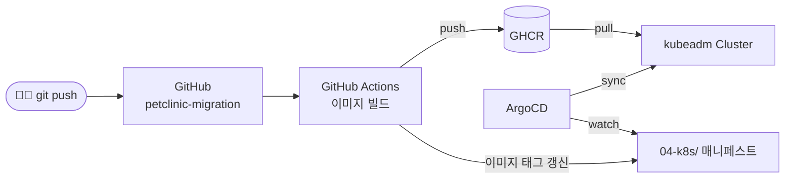

# 🐳 Spring PetClinic 배포 아키텍처 단계적 전환

> 베어메탈 → Docker → Docker Compose → Kubernetes(kubeadm) → GitOps
> 같은 앱 하나로 배포 방식을 단계적으로 바꾸며, **각 단계의 한계를 다음 단계로 해결**한 과정과 수치를 기록합니다.


---

## 📌 목차

- [전체 흐름](#-전체-흐름)
- [Phase 1. 베어메탈 2-Tier](#phase-1-베어메탈-2-tier)
- [Phase 2. Docker 이미지화](#phase-2-docker-이미지화)
- [Phase 3. Docker Compose](#phase-3-docker-compose)
- [Phase 4. Kubernetes (kubeadm)](#phase-4-kubernetes-kubeadm)
- [Phase 5. GitOps](#phase-5-gitops)
- [측정 결과 요약](#-측정-결과-요약)
- [트러블슈팅](#-트러블슈팅)
- [디렉토리 구조](#-디렉토리-구조)

---

## 🗺 전체 흐름



| Phase | 배포 방식 | 해결한 문제 | 남은 한계 |
| --- | --- | --- | --- |
| 1 | VM 2대에 직접 설치 | – | 수동 설치, Java 버전 의존, 비밀번호 평문 |
| 2 | Docker 이미지 | 실행 환경을 이미지로 고정 | 컨테이너·네트워크를 매번 수동 실행 |
| 3 | Docker Compose | 한 줄 배포 (`docker compose up`) | 단일 호스트, 장애 시 자동 복구·무중단 배포 불가 |
| 4 | Kubernetes (kubeadm) | 자가 복구, 롤링 업데이트·롤백, HPA, Secret | 배포가 수동 `kubectl apply` |
| 5 | GitHub Actions + ArgoCD | Git push → 자동 빌드·배포 | – |

---

## Phase 1. 베어메탈 2-Tier

**목표:** 컨테이너 없이 직접 설치해 보고, 무엇이 불편한지 기준점(baseline)을 만든다.



- [ ] server1(WAS) + server2(MariaDB) 구성
- [ ] **측정:** 소스 다운로드 → 접속 확인까지 소요 시간
- [ ] **한계 기록:** 수동 설치 / Java 버전 의존 / 비밀번호 평문 저장

➡️ 상세: [`01-baremetal/`](01-baremetal/)

---

## Phase 2. Docker 이미지화

**목표:** 실행 환경을 이미지로 고정하고, 멀티스테이지 빌드로 이미지 크기를 줄인다.



- [ ] 단일 스테이지(JDK) 이미지 빌드
- [ ] 멀티스테이지(JRE) 이미지 빌드
- [ ] **측정:** `docker images`로 두 이미지 크기 비교 캡처

➡️ 상세: [`02-docker/`](02-docker/)

---

## Phase 3. Docker Compose

**목표:** WAS + DB를 한 줄로 배포하고, 단일 호스트 구성의 한계를 직접 확인한다.



- [ ] `docker compose up` 한 줄 배포 + 소요 시간 측정
- [ ] **한계 실험:** `docker kill petclinic-was` 후 복구 여부 확인 → Phase 4로 넘어가는 이유
  - `restart:` 설정에 따라 결과가 달라질 수 있으므로 **설정값과 함께 기록**

➡️ 상세: [`03-compose/`](03-compose/)

---

## Phase 4. Kubernetes (kubeadm)

**목표:** kubeadm으로 클러스터를 직접 구축하고, 자가 복구·롤백·오토스케일링을 수치로 확인한다.



> **설계 근거:** DB는 클러스터 밖 server2 VM에 두고 앱만 K8s에 배포 — 상태(데이터)를 가진 DB와 무상태 앱의 운영 방식을 분리

| 항목 | 할 일 | 남길 증거 | 완료 |
| --- | --- | --- | --- |
| 배포 | Deployment(replicas 2) + Service + Ingress | `kubectl get all` | ☐ |
| 설정 분리 | DB 접속 정보 ConfigMap, 비밀번호 Secret | 평문 → Secret 전후 비교 | ☐ |
| 자가 복구 | Pod 강제 삭제 | 재생성까지 걸린 시간 (Phase 3과 대비) | ☐ |
| 롤링 업데이트 | v1 → v2 배포, 잘못된 이미지로 실패 → `rollout undo` | 복구까지 걸린 시간 | ☐ |
| HPA | 부하 테스트로 스케일아웃 | Pod 수 변화 캡처 | ☐ |
| 장애 재현 | 메모리 limit 초과 → OOMKilled | `kubectl describe`로 원인 확인 | ☐ |

➡️ 상세: [`04-k8s/`](04-k8s/)

---

## Phase 5. GitOps

**목표:** Git push만으로 빌드부터 클러스터 배포까지 자동화한다. *(수업에서 ArgoCD 학습 후 진행)*



- [ ] GitHub Actions로 이미지 빌드·푸시
- [ ] ArgoCD로 kubeadm 클러스터 자동 배포
- [ ] (선택) EKS 확장

➡️ 상세: [`05-gitops/`](05-gitops/)

---

## 📊 측정 결과 요약

> 실습하면서 채워 나갑니다. 측정 방법은 각 Phase 폴더의 README에 기록합니다.

| 지표 | Phase 1 | Phase 2 | Phase 3 | Phase 4 |
| --- | --- | --- | --- | --- |
| 배포 소요 시간 | – | – | – | – |
| 이미지 크기 (단일 → 멀티스테이지) | | – → – | | |
| 컨테이너/Pod 장애 후 복구 | | | – | – |
| 롤백 소요 시간 | | | | – |
| HPA Pod 수 변화 | | | | – → – |
| DB 비밀번호 저장 방식 | 평문 | | `.env` | Secret |

---

## 🧯 트러블슈팅

막힌 부분은 바로 [`docs/troubleshooting.md`](docs/troubleshooting.md)에 기록합니다.

**미리 알고 가는 함정**

| 증상 | 원인 | 대응 |
| --- | --- | --- |
| `ImagePullBackOff` | 로컬에서 빌드한 이미지는 워커 노드에 없음 | Docker Hub / GHCR에 push 후 사용 |
| HPA `TARGETS <unknown>` | metrics-server가 kubelet 인증서 검증 실패 | `--kubelet-insecure-tls` 인자 추가 (실습 환경 한정) |
| Pod Pending / OOMKilled | Java 앱 메모리 사용량 큼 | 노드 메모리 먼저 확인, requests/limits 조정 |

---

## 📁 디렉토리 구조

```
petclinic-migration/
├── 01-baremetal/   # Phase 1: 설치 절차, 측정 기록
├── 02-docker/      # Phase 2: Dockerfile (single / multi-stage)
├── 03-compose/     # Phase 3: docker-compose.yml, .env.example
├── 04-k8s/         # Phase 4: 매니페스트 (Deployment, Service, Ingress, ConfigMap, Secret, HPA)
├── 05-gitops/      # Phase 5: GitHub Actions, ArgoCD Application
└── docs/
    ├── images/            # 캡처 이미지
    └── troubleshooting.md # 문제 → 원인 → 해결 기록
```

## 🔗 참고

- 애플리케이션: [spring-projects/spring-petclinic](https://github.com/spring-projects/spring-petclinic)
- 실습 환경: 한국폴리텍대학 서울정수캠퍼스 클라우드컴퓨팅 과정 (Docker · Terraform · K8s 수업 연계)
